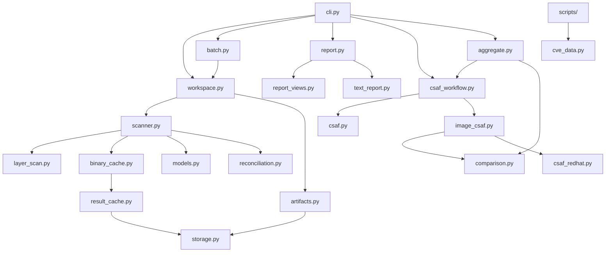

# Architecture and visual overview

## Boundary map

```text
                    optional image-tool world
┌────────────────────────────────────────────────────────────┐
│ oc / skopeo / docker / custom extractor                    │
│                                                            │
│  IMAGE ──extract──> rootfs/                                 │
│                     layers/<extractor-chosen-name>/        │
│                     .pygo-audit-image.json                 │
└────────────────────────────────────────────────────────────┘
                              │ stable directory contract
                              ▼
                    pygo-audit library
┌────────────────────────────────────────────────────────────┐
│ rootfs + optional layer directories                        │
│          │                                                 │
│          ▼                                                 │
│ discover ──> hash/hint ──> cache ──> go -m ──> vulncheck   │
│          │                                      │           │
│          └──────────── BinaryReport ◄───────────┘           │
│                              │                             │
│               compose layer observations                   │
│                              ▼                             │
│                         AuditReport                        │
│                              │                             │
│              audit history / artifacts / views              │
└────────────────────────────────────────────────────────────┘
                              │ audit.json only
                              ▼
                    local comparison in the package
              pygo-audit csaf ──> pygo-audit aggregate
                              ▲
               local CSAF files prepared by vendor adapters
```

The generated image identity sidecar lives beside `rootfs/`, outside
all subject trees. The default metadata lookup never reads an image-owned
sidecar inside the filesystem. Scripts prepare the directory tree; `scan` and
`audit` never invoke an extractor. `cli.py` owns option definitions, defaults,
workspace configuration, and precedence. It passes resolved settings to the
commands. Batch calls the same container-scanning operation with a shared run ID;
`workspace.py` validates subjects and publishes their evidence.

The boundary is intentional. `pygo-audit` consumes directories, not image
registries. The extractor produces directories, not audit conclusions. CSAF
matching consumes serialized audit JSON and local documents. The package's
batch and aggregate commands coordinate these generic workflows; scripts own
vendor discovery, provider URL presets, and metadata preparation.
`fetch-redhat-csaf` passes its source settings to the shared downloader.
Scanning and comparison do not fetch documents.

That is orthogonality in practice: each part has one job and exposes a small
contract. A registry tool can change without changing the scanner. The
scanner can change its model without teaching an image tool about CVEs. A CSAF
provider can change its vocabulary without becoming the owner of binary
discovery.

## Python package responsibilities

The `pygo_audit` package follows the direction data travels: CLI settings enter
at the top, scan or comparison workflows coordinate work, and models, caches,
and storage sit beneath them. Reports are projections of saved models.



These are dependency and call relationships, not additional layers of stored
data. `models.py` defines canonical evidence objects. `audit.py` is the strict
JSON boundary that reconstructs those objects. `report_views.py` derives
reusable finding groups and counts. `report.py` chooses a renderer;
`text_report.py` formats container views using `report_sections.py` and
`text_layout.py`. `aggregate.py` uses the shared CSAF workflow and emits batch
summaries and triage CSV without reimplementing matching or agreement.

| Area | Modules | Responsibility |
| --- | --- | --- |
| Command and workspace | `cli.py`, `workspace.py`, `batch.py` | Parse and resolve settings; validate scan roots; run one scan or coordinate prepared children. |
| Scan evidence | `scanner.py`, `layer_scan.py`, `reconciliation.py`, `vulnerabilities.py` | Discover and inspect binaries, combine rootfs/layer observations, reconcile module inventories, and normalize tool output. |
| CSAF identity and conclusions | `csaf.py`, `image_csaf.py`, `comparison.py`, `csaf_redhat.py`, `csaf_workflow.py` | Index documents, match local products, assess local evidence separately from vendor statements, select Red Hat-specific rules, and publish comparisons. |
| Persistence | `audit.py`, `artifacts.py`, `binary_cache.py`, `result_cache.py`, `storage.py` | Validate saved evidence, manage caches and locks, and publish outputs with rollback for ordinary write failures. |
| Reports | `report.py`, `report_views.py`, `report_sections.py`, `text_layout.py`, `text_report.py`, `aggregate.py` | Derive display-ready groups and render saved evidence at the requested view and verbosity. |
| Data retrieval | `cve_data.py` and `scripts/fetch-*` | Share download, validation, concurrency, and cache behavior while scripts supply provider URL presets. |

The library does not import the scripts. Scripts call shared library code and
own provider-specific URL templates, inventory, and image extraction.
`cve_data.py` is a reusable downloader, not a `pygo-audit` CLI subcommand.

The apparent contradictions are useful because the systems are making
different kinds of statements. Pygo primarily makes syntactic observations
about bytes, build metadata, modules, and `govulncheck` output. VEX primarily
makes semantic assertions about whether a product is affected, how vulnerable
code behaves at runtime, and what resolution applies. The comparison layer
reconciles those descriptions of the same proposed reality: how this string
of binary data will be processed at runtime.

## Scan sequence

```text
1. Validate every root and resolve Go/govulncheck once.
2. Walk regular files without following symlinks.
3. Group hardlinks by device/inode.
4. Check ELF magic.
5. Reopen safely through /proc/self/fd.
6. Stream the file once for SHA-256.
7. Rehydrate a matching cached result, or run Go inspection.
8. Run govulncheck once per uncached content/profile pair.
9. Reconcile declared, SBOM, and finding module observations.
10. Compose rootfs and layer reports, if layers were requested.
11. Serialize one canonical report and derive every view from it.
```

The two kinds of deduplication are different:

```text
same inode in one root       → discover once, retain all paths
same bytes across roots      → hash each observation, inspect once via cache
same CVE across containers   → index local CSAF once per comparison worker
same finding in one report   → group it without discarding binary evidence
```

That is why the project can be fast without pretending that two paths are the
same thing in every context.

## Workspaces, history, and cache validity

A container `AUDIT_ROOT` holds `rootfs/`, optional `layers/layer-000/` etc.,
metadata/settings, `audit.json`, text views, and `history/audit-<ID>-<date>.json`.
A `BATCH_AUDIT_ROOT` holds these as immediate child directories and supplies
shared `cache/` and `work/` defaults. Both root arguments default to cwd.

Scripts own extraction and preparation. The package owns scanning, report
publication, saved-evidence queries, and local advisory comparison. CLI options
override container settings, batch settings, and defaults. Relative sidecar paths
retain the sidecar's directory as their base.

Binary records combine build metadata and vulnerability findings. Static identity
is binary SHA-256 plus Go reader/profile. Dynamic validity additionally
requires the current run ID and vulnerability analysis profile. A batch supplies
one run ID to all targets. A later run refreshes vulnerability data without
repeating unchanged build-metadata extraction. Failed refreshes never fall back to
old vulnerability results.

Paths, layer history, and runtime disposition have explicit `requires-observation`
markers in cached data. The reader consumes these markers and reconstructs current
context. `unknown` is a possible conclusion after inspection, not a cache marker.

Private cache payloads have verified checksum footers. Corrupt/incompatible entries
are misses. No cache contains subject files or substitutes for audit history.
Cache/work/output paths must resolve outside the supplied subjects. Defaults never
fall back to home directories; implicit Go tool state is redirected beneath work/.

The CSAF image check examines each supplied document using image identity from
the audit. It summarizes local evidence, product matching, and agreement with
vendor statements per CVE. Exact matches discard weaker candidates; otherwise
fuzzy matches remain tentative. Local findings, interpreted vendor assessments,
and agreement are separate results. Statements retain their own flags before
their comparison conclusions are combined. A small selector chooses an applicable
vendor/product policy from typed identity and version evidence; Red Hat OpenShift
rules live in `csaf_redhat.py`. Policies preserve raw statements and record their
inferences without changing scan findings. `csaf_workflow.py` orchestrates this
same operation for one container and batches. Shared documents are read/indexed
once per invocation, and identical lookup inputs reuse identity assessments.
Local findings and conclusions are built separately for each container. Batch
comparisons select records by each container's recorded CVEs; standalone checks
continue to inspect every supplied document.

In code, `csaf_workflow.py` owns the comparison lifecycle. `load_workspaces`
reads strict audit data and resolves each image identity. `inspect_source` loads
and indexes a document once, then calls `image_csaf.inspect_document` for each
distinct lookup identity. `compare_workspaces` selects documents and CVEs for
each container and calls `image_csaf.build_comparison`; `publish_checks` stages
all child outputs through `artifacts.py`. The standalone `csaf` command and
`aggregate` therefore share matching, interpretation, and publication. The
aggregate renderer adds batch metrics and CSV rows after per-container
conclusions exist.

`image_csaf.py` owns local-to-CSAF product matching and the per-CVE comparison
record. `csaf.py` parses product trees, CPE relations, relationships, and
canonical URLs. `comparison.py` interprets statements and combines their
conclusions. `csaf_redhat.py` supplies the current Red Hat OpenShift policy for
product and fixed-version interpretation. This keeps vendor heuristics out of
generic document indexing and all comparison logic out of the scanner.

Single-image comparison artifacts are keyed by full binary SHA-256. Locations,
layer history, and runtime availability remain observations of that artifact;
deleted/replaced binaries participate in the same comparison. Different bytes at
the same path remain distinct artifacts.

Report publication stages views, archives the previous canonical JSON, and replaces
current files atomically one at a time, with JSON last. Ordinary failures roll back
views; process interruption may require regenerating views from `audit.json`.
A per-workspace lock rejects simultaneous publishers. Strict failed scans save
diagnostics under `work/` without replacing the current report.

CSAF JSON/text pairs and aggregate JSON/text/CSV bundles use the same artifact
replacement routine. All container and batch views are staged before publication.
Their publisher protects every target's audit, identity override, and advisory
inputs, locks destination directories in a fixed order, and restores previous
files or removes newly created outputs after an ordinary write failure.

Publication locks an existing output directory with standard-library
`fcntl.flock`, leaving no artifact. Publishers fail immediately on contention.
Cache computations wait for a bounded time and then fail explicitly; their
per-key lock files stay in place so every contender locks the same inode. The
kernel releases ownership when the descriptor closes or its process exits.

All saved-evidence commands use the [strict audit contract](audit-contract.md).
The shared reader reconstructs the evidence dataclasses and validates required
fields and types; comparison counters are derived from recorded observations. Derived summaries are computed
from those records. CSAF and aggregate consume one shared CVE evidence index, which retains
vulnerabilities even when they have no finding records.

## Layer composition

Directory discovery is lexicographic by default, with optional numeric
sorting. It establishes scan order, not chronology: the report records layer
presence and final-rootfs availability without inferring deletion or
replacement. Explicit oldest-to-newest `--layer-dir` inputs preserve their
supplied order and permit the historical reasoning shown below. Neither a
registry manifest nor a layer-list file is needed by the scanner.

```text
                 layer-000        layer-001        final rootfs
binary A         FOUND            WHITEOUT         absent
binary B         FOUND            REPLACED          B'
binary C         FOUND            no event          absent
                                                        │
                                                        ▼
                 A → deleted     B → replaced     C → unaccounted
                                                   B' → runtime
```

`layer_scan.py` matches binaries primarily by SHA-256 and falls back to a
path when a hash is unavailable. It records `found`, `deleted`, and `replaced`
events in `layer_history`. The final rootfs is authoritative for `runtime`.
When no later event explains a layer-only binary, the conclusion is
`unaccounted`, not “deleted by vibes.” This is useful forensic context, but it
is deliberately orthogonal to the primary CVE question.

An opaque-directory whiteout counts as deletion evidence for everything below
that directory. A later different binary at the same path counts as
replacement evidence. Missing paths alone never establish either conclusion.

## Report hierarchy

```text
AuditReport (one container)
├── metadata.image
├── scan/toolchain provenance
├── binaries[]
│   ├── identity and paths
│   ├── runtime_disposition
│   ├── layer_history[]
│   ├── vulnerability_scan
│   └── reconciliation
├── issues[]
└── stats
```

The JSON is the canonical intermediate representation. Text reports are views,
not alternate databases. Aggregation preserves canonical container comparisons in
`reports/aggregate.json` without changing its structure. The text views separate
batch statistics (`aggregate.txt`), per-CVE comparisons (`cve-aggregates.txt`),
and per-container statistics (`container-aggregates.txt`). The spreadsheet
`pygo-audit-triage.csv` has one row per container/CVE. Totals count the existing
agreement, local scan, match, and vendor conclusions;
the aggregate does not evaluate them again. Triage rows sort by descending highest
CVSS score, then container, agreement priority, and CVE. Missing or ambiguous
evidence retains its qualifications. Full scan evidence remains in `audit.json`.
An explicit aggregate output directory also contains a comparison JSON/text pair
under a subdirectory named for each container; the usual per-container reports
continue to be refreshed in their audit workspaces.
Batch `audit`, `csaf`, and `aggregate` share one helper for those per-container
bundle paths. Batch audit mirrors the canonical JSON and scan views into that
bundle while keeping its working audit and caches in the audit workspace.
JSON keys match the evidence dataclass fields. Computed properties such as
runtime counts, CGO status, and dependency summaries are not duplicated in storage.

## Fallibility principle

We want accurate, precise determinations, while accepting that every model is
fallible. Precision is valuable because it lets us analyze inaccuracy instead
of hiding it behind a single vague failure status. The scanner therefore
separates:

- operational errors: a required operation failed;
- incomplete coverage: not every recognized binary received a complete scan;
- reconciliation differences: representations disagree but the scan still
  produced evidence;
- runtime disposition uncertainty: layer evidence did not support a stronger
  conclusion.

These are not interchangeable. A report can be vulnerable and operationally
healthy, clean but incomplete, or complete with an informational semantic
reconciliation difference. The architecture keeps those axes separate because
“one status to rule them all” is how dashboards become haunted.

The comparison should expose disagreement in both directions. “VEX says the
code is affected, pygo cannot find the compiled code” and “pygo finds evidence,
VEX says the vulnerable code is absent” are both worth review. If independent
wording leads to the same concrete conclusion — for example, both can
establish that the vulnerable compiled code is not in the supplied filesystem —
that is agreement, or perhaps violent agreement, not a contradiction.
